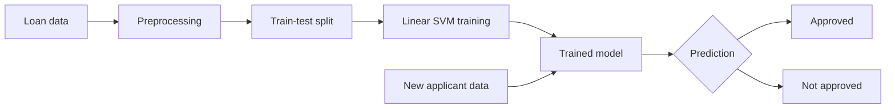

# Loan Status Prediction using Machine Learning

A machine learning project that predicts whether a loan application will be approved, based on applicant details such as income, credit history, education, and marital status. The model is a linear Support Vector Machine built with Scikit-learn.

## Overview

Loan approval decisions depend on many applicant attributes. This project walks through the full workflow of turning that data into a working classifier: cleaning the data, exploring it, encoding features, training a model, evaluating it, and using it to predict the outcome for a new applicant.

## Workflow



## How the model works

A Support Vector Machine separates two classes (here, approved and rejected loans) by finding the hyperplane that leaves the widest possible margin between them. The training points closest to that boundary are the support vectors, and they are the only points that determine where the boundary sits. With more than two features, the boundary becomes a hyperplane in higher-dimensional space, which is the case for this dataset's 11 input features.

`LinearSVC` fits this kind of linear boundary and is well suited to datasets of this size.

## Dataset

`dataset.csv` contains 614 loan applications with 13 columns.

| Column | Description |
| --- | --- |
| `Loan_ID` | Unique loan identifier (dropped before training) |
| `Gender` | Male / Female |
| `Married` | Marital status (Yes / No) |
| `Dependents` | Number of dependents (0, 1, 2, 3+) |
| `Education` | Graduate / Not Graduate |
| `Self_Employed` | Self-employment status (Yes / No) |
| `ApplicantIncome` | Applicant's income |
| `CoapplicantIncome` | Co-applicant's income |
| `LoanAmount` | Loan amount requested |
| `Loan_Amount_Term` | Loan term |
| `Credit_History` | Credit history meets guidelines (1) or not (0) |
| `Property_Area` | Rural / Semiurban / Urban |
| `Loan_Status` | Target: loan approved (Y) or not (N) |

## Workflow

1. **Data loading and cleaning**: Loaded the data with Pandas and checked for missing values. Rows with missing values were dropped, leaving 480 records.
2. **Preprocessing**: Encoded `Loan_Status` as 0/1, replaced `3+` dependents with `4`, and converted the remaining categorical columns (`Gender`, `Married`, `Education`, `Self_Employed`, `Property_Area`) to numeric values.
3. **Visualization**: Used Seaborn count plots to look at how education and marital status relate to loan approval.
4. **Train-test split**: 90:10 split with stratified sampling to keep the approved/rejected ratio the same in both sets (`random_state=2`).
5. **Model training**: Trained a linear SVM using Scikit-learn's `LinearSVC` (`max_iter=5000`).
6. **Evaluation**: Measured accuracy on the training and test sets.
7. **Predictive system**: Takes a single applicant's details as input and prints whether the loan is approved.

## Results

| Set | Accuracy |
| --- | --- |
| Training | 80.56% |
| Testing | 83.33% |

The test set is small (48 applications), so these numbers should be read as a baseline rather than a precise estimate of real-world performance.

## Example prediction

Input features, in order: `Gender, Married, Dependents, Education, Self_Employed, ApplicantIncome, CoapplicantIncome, LoanAmount, Loan_Amount_Term, Credit_History, Property_Area`

```python
input_data = (1, 1, 0, 1, 0, 2180, 274, 150, 360, 1, 2)

input_data_df = pd.DataFrame([input_data], columns=X.columns)
prediction = classifier.predict(input_data_df)

if prediction[0] == 1:
    print('The loan is approved.')
else:
    print('The loan is not approved.')
```

## Tech stack

Python, Pandas, NumPy, Seaborn, Scikit-learn

## Getting started

1. Clone the repository:
   ```bash
   git clone https://github.com/<your-username>/<your-repo-name>.git
   cd <your-repo-name>
   ```
2. Install the dependencies:
   ```bash
   pip install numpy pandas seaborn scikit-learn jupyter
   ```
3. Open `LoanStatusPrediction.ipynb` in Jupyter or Google Colab and run the cells in order.

The notebook reads the data from `/content/dataset.csv` (the Google Colab path). If you run it locally, change this to `dataset.csv`.

## Project structure

```
.
├── LoanStatusPrediction.ipynb   # Full workflow: preprocessing to prediction
├── dataset.csv                  # Loan application data
└── README.md
```

## Possible improvements

- Scale numeric features such as income and loan amount before training
- Impute missing values instead of dropping rows
- Use cross-validation for a more reliable accuracy estimate
- Report precision, recall, and a confusion matrix, since approvals outnumber rejections
- Compare against other models such as Logistic Regression, Random Forest, and an RBF-kernel SVM

## Acknowledgements

Built while following Siddhardhan's loan status prediction tutorial on YouTube, with my own modifications (such as using `LinearSVC`).

## Author

<your name> - [LinkedIn](<your-linkedin-url>)
